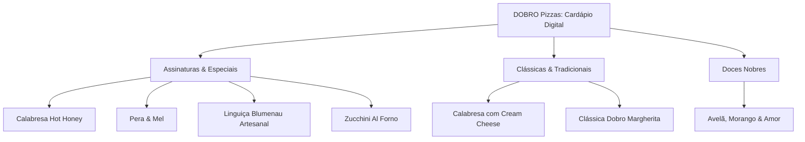

# DOBRO PIZZAS — BRANDBOOK & MANUAL DE IDENTIDADE VISUAL
*Guia Estratégico, Sistema Visual, Expressão Verbal & Padrões Operacionais*

---

## 1. Plataforma Estratégica & Manifesto

### 1.1 A Big Idea: "O Poder do Dobro"
A maioria das pizzarias compete por preço ou por conveniência rápida. A **DOBRO Pizzas** nasce com outra premissa: **a abundância com critério**. 

O conceito do "DOBRO" não significa apenas mais quantidade. Significa:
- **O dobro de tempo:** fermentação lenta de 48h a 72h que transforma farinhas selecionadas em uma massa leve, aerada e de digestão perfeita.
- **O dobro de sabor:** ingredientes com denominação de origem, linguiça Blumenau artesanal, queijos nobres fundidos no ponto ideal e toques autorais como o mel picante (*Hot Honey*).
- **O dobro de afeto:** a certeza de que abrir uma caixa de pizza em casa é um momento sagrado de celebração, partilha e conexão entre amigos e família.

> [!NOTE]
> **Posicionamento de Mercado:** Pizzaria Artesanal Contemporânea Premium. Ticket médio-alto, foco em experiência gastronômica autoral no salão e delivery com embalagem protetora e unboxing memorável.

---

### 1.2 Manifesto da Marca

> *"A vida é curta demais para comer pizza comum.*  
>  
> *Acreditamos no tempo que a massa pede para respirar, no estalo da lenha aquecendo a pedra e no aroma inconfundível do manjericão fresco ao tocar o calor.*  
>  
> *Para nós, pizza não é refeição rápida: é matéria de celebração. É onde a técnica italiana encontra a alma brasileira dos recheios generosos e memoráveis.*  
>  
> *Servimos com fartura porque quem senta à mesa conosco merece o melhor.*  
>  
> *Não fazemos o simples quando podemos fazer com excelência.*  
> *Não entregamos o básico quando podemos entregar o dobro.*  
>  
> **DOBRO Pizzas. O dobro de sabor, o dobro de afeto.**"

---

## 2. Brand Style Guide Oficial (Prancha Visual)

Inspirado na referência de identidade visual limpa e editorial do projeto, este é o painel de diretrizes visuais consolidadas da **DOBRO Pizzas**:


---

## 3. Sistema Visual & Design Tokens

### 3.1 Paleta Cromática Técnica

A paleta da DOBRO Pizzas é fundamentada na natureza rústica e sofisticada da gastronomia artesanal: folhas de oliveira, trigo maduro, fornos a lenha e linho cru.

| Cor | Nome Poético | HEX | RGB | CMYK | Aplicação Principal |
| :--- | :--- | :--- | :--- | :--- | :--- |
|  **Verde Floresta** | *Deep Forest Pine* | `#083D07` | `8, 61, 7` | `87, 0, 89, 76` | Logotipo principal, botões de ação (CTA), embalagens, contrastes nobres |
|  **Linho Natural** | *Warm Linen Stone* | `#E8D8D1` | `232, 216, 209` | `0, 7, 10, 9` | Fundo oficial da marca, base da logo, papéis especiais, cartões |
|  **Espresso Escuro** | *Dark Roasted Earth* | `#44210F` | `68, 33, 15` | `0, 51, 78, 73` | Textos principais, títulos escuros, rodapé, elementos de alta legibilidade |
|  **Dourado Trigo** | *Warm Ochre Wheat* | `#D5AF7A` | `213, 175, 122` | `0, 18, 43, 16` | Destaques sutis, selos de qualidade, bordas especiais, acentos na interface |
|  **Blush Suave** | *Soft Porcelain Rose* | `#F6E3DF` | `246, 227, 223` | `0, 8, 9, 4` | Fundos de cards, badges de promoções, backgrounds secundários suaves |
|  **Terracota Artesanal** | *Roasted Cocoa Wood* | `#745240` | `116, 82, 64` | `0, 29, 45, 55` | Textos secundários, bordas de cards, elementos rústicos, etiquetas |
|  **Nude Terracota** | *Sand Terracotta* | `#E4C5B9` | `228, 197, 185` | `0, 14, 19, 11` | Linhas divisórias, submenus, papéis de seda e embalagens secundárias |

---

### 3.2 Tipografia Oficial

A harmonia tipográfica combina a modernidade geométrica e funcional da **Poppins** com a elegância clássica atemporal de uma fonte serifada (**Lora / Playfair**):

```
FONTE PRINCIPAL (Interface, Corpo de Texto & Leitura Dinâmica):
Poppins (Google Fonts)
Pesos: Light (300), Regular (400), Medium (500), SemiBold (600), Bold (700)
Uso: Nomes de produtos, descrições no cardápio, PDV, sistema de caixa, botões e WhatsApp.

FONTE SECUNDÁRIA / DISPLAY (Títulos Editoriais, Menus Impressos & Assinaturas):
Lora / DM Serif Display / Playfair
Pesos: Regular (400), Bold (700), Italic (400)
Uso: Slogans poéticos ("O Dobro de Sabor, O Dobro de Afeto"), cartões de agradecimento, títulos de categorias gourmet e capas.
```

---

### 3.3 Ícones & Ilustrações Lineares (Estilo Minimalista)

O universo gráfico da DOBRO Pizzas adota traços lineares finos e limpos em Verde Floresta (`#083D07`) ou Dourado Trigo (`#D5AF7A`), como apresentado na prancha de diretrizes:
- **Fatia de Pizza Rústica:** Representa o corte artesanal e a massa aerada.
- **Forno a Lenha Cúpula:** Remete à tradição e alta temperatura (ponto de ouro).
- **Ramos Botânicos & Espigas de Trigo:** O símbolo presente no logotipo oficial, evocando matéria-prima nobre e naturalidade.
- **Gotas de Hot Honey / Pote de Mel:** Elemento icônico das receitas autorais da casa.
- **Pimenta Suave / Folhas de Manjericão:** Toque de frescor gastronômico.

---

## 4. Aplicações no Mundo Real (Mockups Oficiais)

### 4.1 A Caixa de Pizza Premium (O Outdoor no Lar do Cliente)
A caixa de entrega é feita em papel cartão kraft espesso com acabamento natural, bordas verdes escuras contrastantes e o logotipo **DOBRO Pizzas** em relevo seco / silk de alta precisão.


---

### 4.2 Kit de Delivery & Papelaria Gastronômica
Composto por sacola kraft com alça torcida, papel antigordura timbrado com padrão botânico de ramos, selos adesivos de segurança e cartão de menu dobrável.


---

## 5. Tom de Voz & Comunicação

| Situação | Como a DOBRO Fala | O Que Evitar |
| :--- | :--- | :--- |
| **Boas-Vindas** | "Boa noite! Bem-vindo à Dobro. Nosso forno já está aceso e a massa de fermentação lenta no ponto perfeito para você." | "Oi, quer pedir o que hoje?" |
| **Descrição de Sabores** | "Calabresa artesanal levemente tostada, finalizada com azeite de ervas e o nosso exclusivo Hot Honey picante da casa." | "Pizza de calabresa com mel." |
| **Tempo de Espera** | "Sua redonda acabou de sair do forno a lenha e está a caminho, quente e crocante. Em cerca de 35 minutos você vai sentir esse aroma na sua mesa." | "O motoboy já saiu." |
| **Agradecimento** | "Obrigado por partilhar essa noite com a Dobro. Foi um prazer preparar cada fatia para vocês!" | "Valeu, até a próxima." |

---

## 6. Cardápio Digital & Produtos Integrados

Os 7 produtos autorais da pasta oficial de fotos da Dobro foram catalogados e integrados com alta resolução, links diretos e descrições gastronômicas:



### Detalhamento dos Produtos no Sistema:
1. **Calabresa Hot Honey** (`/dobro/calabresa-hot-honey.jpeg`)
   *Massa artesanal de fermentação lenta, molho pomodoro rústico, mozzarella especial, rodelas tostadas de calabresa defumada nobre e finalização com infusão exclusiva de mel picante da casa (Hot Honey).*
2. **Pera & Mel** (`/dobro/pera-mel.jpeg`)
   *Base aveludada de queijo gorgonzola e mozzarella selecionada, lâminas frescas de pera, nozes crocantes e fio generoso de mel puro de flor de laranjeira.*
3. **Linguiça Blumenau Artesanal** (`/dobro/blumenau.jpeg`)
   *Autêntica linguiça Blumenau defumada artesanalmente e assada no forno, molho pomodoro fresco, queijo mozzarella derretido, cebola roxa finamente fatiada e alecrim fresco.*
4. **Zucchini Al Forno** (`/dobro/zucchini.jpeg`)
   *Massa de fermentação natural, lâminas delicadas de abobrinha italiana marinadas no azeite extravirgem, mozzarella cremosa, lascas de parmesão e raspas perfumadas de limão siciliano.*
5. **Calabresa com Cream Cheese** (`/dobro/calabresa-cream-cheese.jpeg`)
   *Molho de tomate caseiro, mozzarella especial em ponto de ouro, calabresa defumada artesanal e generosas gotas de cream cheese cremoso gratinadas no forno.*
6. **Clássica Dobro** (`/dobro/classica.jpeg`)
   *A clássica margherita elevada: molho rústico de tomates pelados, mozzarella farta, tomatinhos cereja doces confitados e folhas frescas de manjericão aromático.*
7. **Avelã, Morango & Amor** (`/dobro/avela-morango-amor.jpeg`)
   *Massa doce artesanal crocante, camada farta do mais puro creme nobre de cacau e avelãs, fatias frescas de morangos suculentos selecionados e lascas tostadas de amêndoas.*

---

## 7. Integrações Técnicas: PDV, CRM & Gestor

O sistema web agora reflete a identidade visual oficial da DOBRO Pizzas:
- **Design Tokens:** Aplicados no [adminDesignTokens.ts](file:///c:/Users/herek/OneDrive/Área de Trabalho/dobropizza/pizzaria-&-esfiharia-delivery%20%286%29/src/adminDesignTokens.ts) e [index.css](file:///c:/Users/herek/OneDrive/Área de Trabalho/dobropizza/pizzaria-&-esfiharia-delivery%20%286%29/src/index.css) com os tons Verde Floresta (`#083D07`), Linho Natural (`#E8D8D1`) e Dourado Trigo (`#D5AF7A`).
- **PDV (Ponto de Venda):** Pronto para operações de balcão e telefone com botões ergonômicos e fluxo rápido.
- **CRM & Funil de Vendas:** Mapeamento de clientes por frequência de compra, histórico e LTV.
- **Cardápio Digital:** Responsivo mobile/desktop com carrinho inteligente, cálculo de entrega e disparo de pedidos direto via WhatsApp.
